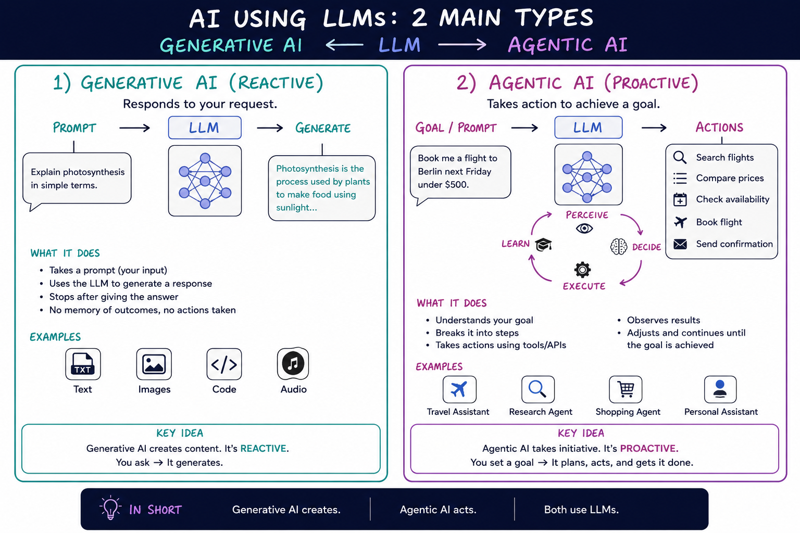

# Module 1 — Introduction to LLMs

> **Course:** LLM Red Teaming  
> **Goal:** Build the basic understanding of LLMs needed for the later red-team modules.

---

## 1. Learning Objectives

This module covers:

- What Large Language Models are
- How transformer-based LLMs work at a high level
- The lifecycle of an LLM
- Common business applications
- Different types of LLMs
- Resource requirements
- Hosting options

The detailed LLM threat model, including OWASP and MITRE ATLAS, is covered later in the course.

---

# 2. What Are LLMs?



## 2.1 Generative AI

**Generative AI** refers to systems that create new content, such as:

- Text
- Images
- Audio
- Video
- Source code

Large Language Models are generative AI systems focused mainly on understanding and generating text.

An LLM receives text as input and predicts which token should come next. This process is repeated until the complete answer is generated.

```text
Input prompt
    ↓
Tokenization
    ↓
Model processes the tokens
    ↓
Next-token prediction
    ↓
Generated response
```

---

# 3. Historical Overview

Human language is sequential. The meaning of a word often depends on words that appeared earlier or later.

Early NLP approaches included:

- Rule-based systems
- Statistical language models
- Neural networks
- Recurrent Neural Networks
- Long Short-Term Memory networks
- Transformers

## 3.1 Neural Networks

A neural network consists of connected layers of nodes.

Each connection has a numerical value called a **weight** or **parameter**.

During training:

1. The model receives an input.
2. It generates a prediction.
3. The prediction is compared with the correct result.
4. A loss function measures the error.
5. Backpropagation adjusts the weights.
6. The process is repeated many times.

The goal is to reduce the loss and improve future predictions.

---

## 3.2 Recurrent Neural Networks

Recurrent Neural Networks, or **RNNs**, were designed for sequential data such as text and voice.

They process tokens one after another while maintaining a **hidden state**.

The hidden state acts as a memory of previously processed tokens.

```text
Token 1 → Hidden state
Token 2 + previous hidden state → Updated hidden state
Token 3 + previous hidden state → Updated hidden state
```

This allowed RNNs to understand relationships between words in a sentence.

### Limitation: Vanishing Gradients

RNNs struggle with long sequences.

During training, the error must travel backward through many time steps. The gradient can become very small, making it difficult for the model to learn relationships between words that are far apart.

This is known as the **vanishing gradient problem**.

---

## 3.3 Long Short-Term Memory

**LSTMs** are a special type of RNN designed to retain important information for longer periods.

They use:

- A cell state
- A forget gate
- An input gate
- An output gate

These components allow the model to decide:

- What information to remember
- What information to remove
- What information to use for the next step

LSTMs improved long-range understanding, but they still processed text sequentially, which made training slow for long inputs.

---

# 4. Transformer-Based LLMs [text](https://poloclub.github.io/transformer-explainer/)

In 2017, the paper **Attention Is All You Need** introduced the transformer architecture.

Unlike RNNs and LSTMs, transformers do not need to process every token strictly one after another when analyzing an input.

Instead, they use **self-attention** to compare tokens with other tokens in the sequence.

This makes transformers:

- More efficient on modern hardware
- Better at handling long-range relationships
- Easier to train at large scale

Most modern LLMs are transformer-based.

---

## 4.1 Tokenization

Before an LLM can process text, it must divide it into smaller units called **tokens**.

Tokens can be:

- Complete words
- Parts of words
- Characters
- Punctuation

Example:

```text
empowers
```

may be split into:

```text
["em", "powers"]
```

Different models use different tokenization methods.

Common strategies include:

- Byte-Pair Encoding
- WordPiece
- SentencePiece
- Unigram


### Red-Team Relevance

Tokenization matters because:

- The same text may be tokenized differently by different models.
- Some languages may require more tokens than others.
- Rare or unusual tokens may produce unexpected behavior.
- Adversarial suffixes often depend on the target tokenizer.
- A technique that works against one model may not transfer to another.

---

## 4.2 Token Embeddings

Tokens must be converted into numerical representations before the model can process them.

An **embedding** represents a token as a vector.

Example:

```text
[0.33, 0.55, -1.77, ...]
```

During training, tokens used in similar contexts often develop similar vector representations.

Similarity between vectors can be measured using methods such as:

- Euclidean distance
- Cosine similarity

Real embeddings contain many dimensions and are not directly understandable by humans.

---

## 4.3 Positional Information

Transformers process many tokens together, so they need a way to understand token order.

Positional information helps the model distinguish between sentences such as:

```text
The rabbit stole the flower.
```

and:

```text
The flower stole the rabbit.
```

Common approaches include:

- Positional encodings
- Rotary Position Embeddings
- Attention with Linear Biases

---

# 5. Context Windows

The **context window** is the maximum number of tokens a model can process in a single request.

The context may contain:

- System instructions
- User input
- Conversation history
- Retrieved documents
- Generated output

If the input exceeds the context limit, content must be:

- Truncated
- Summarized
- Split into smaller parts
- Retrieved only when needed

## 5.1 Lost in the Middle

Models may use information at the beginning and end of a long context more effectively than information placed in the middle.

This means:

```text
Information being present in the context
does not guarantee that the model will use it correctly.
```

### Red-Team Relevance

An attacker may try to:

- Place malicious instructions near the beginning or end
- Hide malicious instructions inside retrieved documents
- Push defensive instructions into a less influential position
- Fill the context window so important content is truncated
- Increase resource usage with very long prompts

These topics are covered in more detail in later modules.

---

# 6. Self-Attention

Self-attention allows each token to consider other tokens in the sequence.

For every token, the model creates:

- A Query
- A Key
- A Value

## 6.1 Query

The Query represents the token currently looking for relevant information.

## 6.2 Key

The Key represents information used to determine how relevant another token is to the Query.

## 6.3 Value

The Value contains the information that will influence the final representation.

The model calculates attention scores to determine which tokens are most relevant.

Example:

```text
Data visualization empowers users to
```

For the token `empowers`, the model may give more attention to:

- `Data`
- `visualization`
- `users`

because they help explain who performs the action and who receives it.

---

## 6.4 Multi-Head Attention

Transformers use multiple attention heads.

Different heads can learn different relationships, such as:

- Subject and verb relationships
- Adjective and noun relationships
- Long-range dependencies

The results of the attention heads are combined before being passed to the next layer.

---

## 6.5 MLP Layer

After self-attention, the output passes through a Multi-Layer Perceptron, also called a feedforward layer.

This layer further transforms the internal token representations.

A simplified transformer block can be remembered as:

```text
Self-attention
      ↓
Feedforward / MLP layer
      ↓
Next transformer block
```

---

# 7. Next-Token Prediction

After processing the input, the model assigns a score to possible next tokens.

A Softmax function converts these scores into a probability distribution.

Example:

```text
visualize → highest probability
create    → lower probability
see       → lower probability
```

The model then selects one token and repeats the process.

## 7.1 Deterministic and Non-Deterministic Output

A model can generate output in different ways.

### Greedy Decoding

The model always selects the highest-probability token.

This usually produces more predictable output.

### Sampling

The model selects from several possible tokens.

Common settings include:

- Temperature
- Top-k
- Top-p

Sampling introduces controlled randomness, so the same prompt may produce different answers.

### Red-Team Relevance

When testing an LLM:

- Repeat important tests several times.
- Record the model and generation settings.
- Do not assume one successful refusal means the model is always safe.
- Do not assume one failed attack means the attack never works.

---

# 8. Lifecycle of an LLM

An LLM usually passes through several stages.

```text
Randomly initialized model
        ↓
Pre-training
        ↓
Supervised fine-tuning
        ↓
Alignment training
        ↓
Inference
```

---

## 8.1 Pre-Training

During pre-training, the model learns general language patterns from very large datasets.

The main objective is usually next-token prediction.

The result is a **base model**.

---

## 8.2 Supervised Fine-Tuning

Supervised Fine-Tuning, or **SFT**, adapts the base model to follow instructions or perform specific tasks.

Examples include:

- Question answering
- Summarization
- Coding assistance
- Domain-specific support

---

## 8.3 Reinforcement Learning from Human Feedback

**RLHF** is used to shape model behavior based on human preferences.

A simplified RLHF process is:

```text
Generate multiple answers
        ↓
Humans compare the answers
        ↓
Train a reward model
        ↓
Optimize the LLM using the reward signal
```

RLHF attempts to make the model more:

- Helpful
- Honest
- Harmless
- Consistent with expected behavior

---

## 8.4 PPO and DPO

**Proximal Policy Optimization**, or PPO, is one technique used to optimize a model against a reward model.

**Direct Preference Optimization**, or DPO, trains directly from preferred and rejected answer pairs without requiring a separate reward-model optimization loop.

The important point for this course is that both methods shape model behavior based on preferences.

---

## 8.5 Alignment Limitations

Alignment training is not perfect.

Common weaknesses include:

### Reward Hacking

The model learns to optimize the reward signal instead of the real intention.

### Distribution Shift

The model may behave differently when it receives inputs unlike those used during training.

Examples include:

- Unusual encodings
- Low-resource languages
- Long conversations
- Role-play
- Adversarial prompts

### Refusal Bypass

The model may still contain the underlying capability even when trained to refuse certain requests.

Attackers may try to bypass or confuse the refusal behavior.

These techniques are covered later in the LLM Jailbreaking module.

---

## 8.6 Constitutional AI

Constitutional AI uses a written set of principles to guide model behavior.

The model can critique and revise its own answer according to these principles.

This reduces the need for human feedback on every example, but it does not completely remove alignment weaknesses.

---

## 8.7 Inference

During inference, the model uses its fixed trained weights to generate responses.

The model normally does not update its weights during each request.

Without updated training, fine-tuning, retrieval, or external tools, the model's knowledge can become outdated over time.

---

# 9. Business Applications

## 9.1 Customer Support

LLMs can:

- Answer common questions
- Support chatbots
- Assist call centers
- Route customer requests

## 9.2 Content Creation

LLMs can generate drafts for:

- Marketing content
- Social-media posts
- Articles
- Product descriptions
- Educational materials

Human review is often still required.

## 9.3 Document Processing

LLMs can:

- Summarize documents
- Extract information
- Search large document collections
- Identify relevant records

This can reduce the time required for manual document analysis.

---

# 10. Types of LLMs

## 10.1 Open-Source and Proprietary Models

### Open-Source or Open-Weight Models

These models make some or all of the following publicly available:

- Model weights
- Architecture
- Training or inference code

Advantages:

- More customization
- More transparency
- Local deployment
- Greater control over data

Disadvantages:

- Requires internal expertise
- Requires infrastructure
- Organization is responsible for maintenance

### Proprietary Models

These models are accessed through:

- APIs
- Web interfaces
- Cloud platforms

Advantages:

- Easy to integrate
- Provider manages hosting and updates
- Less infrastructure effort

Disadvantages:

- Less transparency
- Less control
- Usage costs
- Dependence on the provider

---

## 10.2 General-Purpose Models

General-purpose models support many tasks, such as:

- Translation
- Summarization
- Coding
- Chat
- Content generation

They are flexible but may not be highly specialized.

---

## 10.3 Domain-Specific Models

Domain-specific models are adapted for areas such as:

- Medicine
- Finance
- Law
- Cybersecurity

They may perform better in their domain but be less flexible outside it.

---

## 10.4 Task-Specific Models

Task-specific models are optimized for a narrow function, such as:

- Sentiment analysis
- Classification
- Summarization
- Information extraction

They are efficient for one task but not designed for general use.

---

## 10.5 Small and Large Language Models

### Small Language Models

Advantages:

- Faster
- Cheaper
- Easier to run locally
- Suitable for edge devices

Limitations:

- Less capable on complex tasks
- More limited context and reasoning ability

### Large Language Models

Advantages:

- More capable across many tasks
- Better language understanding
- Better performance on complex prompts

Limitations:

- Higher cost
- Greater hardware requirements
- More operational complexity

Organizations must balance performance, cost, speed, and privacy.

---

# 11. Resource Requirements

The required resources depend on the lifecycle stage.

## 11.1 Training From Scratch

This is the most resource-intensive option.

It may require:

- Hundreds or thousands of GPUs or TPUs
- Large datasets
- High-speed networking
- Large storage systems
- Cooling and power infrastructure
- Specialized engineers
- Weeks or months of training

This option is usually limited to large companies, research labs, or government-backed projects.

---

## 11.2 Inference

Inference uses an already trained model.

Requirements depend on model size.

Smaller models may run on CPUs, while larger models usually require GPUs.

Organizations must consider:

- GPU memory
- Storage
- Network bandwidth
- Response time
- Power consumption
- Maintenance
- Licensing or API cost

Inference is much cheaper than training from scratch but still requires planning.

---

## 11.3 Fine-Tuning

Fine-tuning customizes an existing model for a domain or task.

It requires less compute than full pre-training.

Methods such as **LoRA** reduce the amount of model parameters that need to be updated.

Fine-tuning may take from minutes to several days, depending on:

- Model size
- Dataset size
- Hardware
- Fine-tuning method

### Security Concern

Fine-tuning on sensitive data can lead to:

- Memorization
- Privacy violations
- Data leakage
- Compliance problems

For example, a model fine-tuned on medical records may unintentionally expose patient information.

---

# 12. Hosting Options

## 12.1 On-Premises Hosting

The model runs on infrastructure controlled by the organization.

Advantages:

- Full control
- Strong data-governance options
- Local customization
- Suitable for sensitive environments

Disadvantages:

- High upfront cost
- Hardware maintenance
- Difficult scaling
- Need for specialized staff

This is often preferred by organizations with strict security or compliance requirements.

---

## 12.2 Cloud Hosting

The model runs on a cloud provider such as:

- AWS
- Microsoft Azure
- Google Cloud
- Hugging Face

Advantages:

- Fast deployment
- Flexible scaling
- Managed services
- No initial hardware purchase

Disadvantages:

- Ongoing cost
- Provider dependency
- Privacy and data-residency concerns
- Need to review provider security policies

Cloud hosting is well suited to organizations with changing workloads.

---

## 12.3 Hybrid Hosting

Hybrid hosting combines on-premises and cloud infrastructure.

Example:

```text
Sensitive workload → On-premises
Additional capacity → Cloud
```

A common approach is **cloud bursting**, where the organization uses its own infrastructure normally and sends overflow workload to the cloud.

Advantages:

- Combines control and scalability
- Uses existing infrastructure
- Supports sensitive workloads

Disadvantages:

- Greater complexity
- More difficult network integration
- Data synchronization challenges
- Different security controls across environments

---

# 13. Deployment Comparison

| Requirement | On-Premises | Cloud | Hybrid |
|---|---:|---:|---:|
| Full control | High | Lower | High |
| Fast deployment | Low | High | Medium |
| Elastic scaling | Low | High | High |
| Initial investment | High | Low | Medium |
| Operational complexity | High | Low–Medium | High |
| Suitable for sensitive data | High | Depends on configuration | High |

---

# 14. Red-Team Relevance of This Module

The main security lessons from this chapter are:

1. LLMs generate output probabilistically.
2. Tokenization affects how attacks are interpreted.
3. Long contexts can weaken attention and increase cost.
4. The position of instructions can influence behavior.
5. Alignment training can be bypassed.
6. Fine-tuning can introduce data leakage.
7. Hosting choices change the attack surface.
8. Open and proprietary models create different security responsibilities.
9. The model's knowledge may be outdated.
10. A refusal from the model is not the same as a technical security control.

Later modules build on these concepts to cover:

- Prompt injection
- Indirect prompt injection
- Jailbreaking
- Sensitive-information disclosure
- Resource exhaustion
- Model and application security

---

# 16. Quick Review

## LLM Processing

```text
Text
  ↓
Tokens
  ↓
Embeddings and positional information
  ↓
Self-attention
  ↓
MLP layers
  ↓
Next-token probabilities
  ↓
Generated output
```

## LLM Lifecycle

```text
Pre-training
    ↓
Supervised fine-tuning
    ↓
Alignment training
    ↓
Inference
```

## Deployment Options

```text
On-premises → Maximum control
Cloud       → Fast deployment and scaling
Hybrid      → Combination of control and flexibility
```

## Important Security Points

```text
Tokenization affects attacks.
Context position matters.
Long prompts increase cost and complexity.
Alignment can fail outside its training distribution.
Fine-tuning can leak sensitive information.
Hosting decisions change the threat model.
```

---

# 17. Module Summary

This module introduced the basic concepts required to understand LLM-backed systems.

We covered:

- The development from RNNs and LSTMs to transformers
- Tokenization and embeddings
- Positional information
- Context windows
- Self-attention
- Next-token generation
- The LLM lifecycle
- Alignment methods
- Business use cases
- Model types
- Resource requirements
- Hosting options

This foundation is necessary before moving into practical LLM interaction, customization, prompt injection, jailbreaking, and other red-team techniques.
