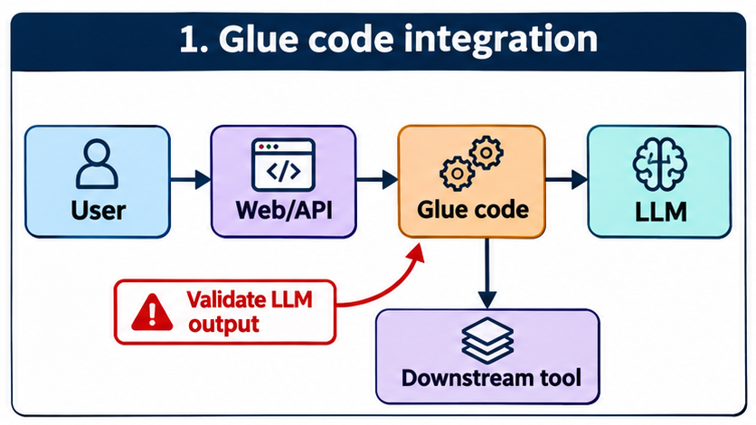
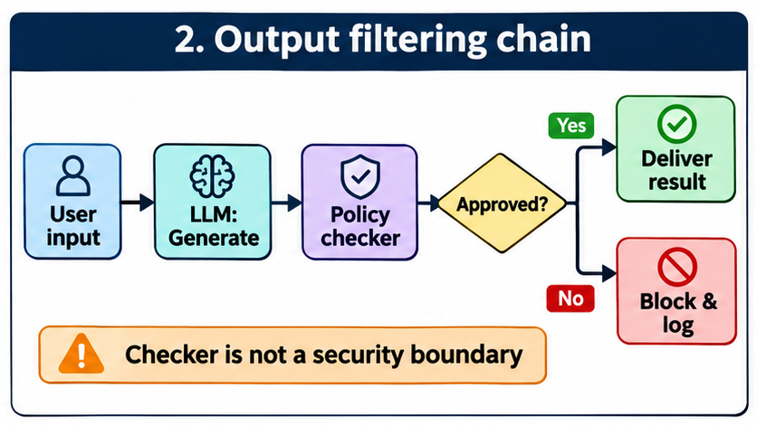
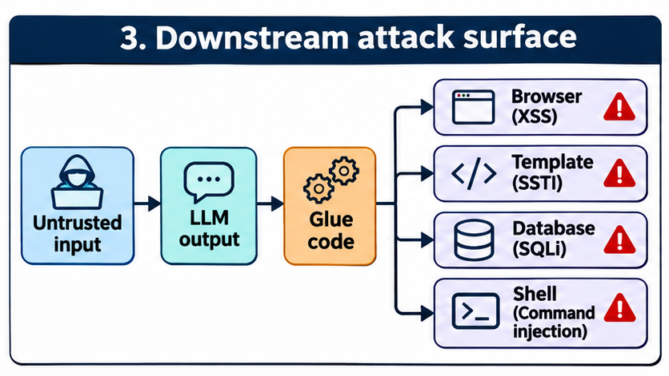
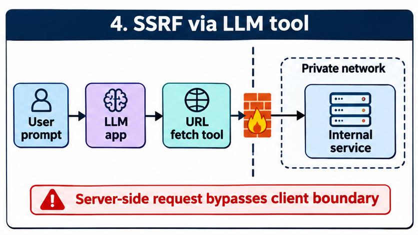

# 8. Improper Output Handling in LLM Applications

> **A practical, standalone guide to OWASP LLM05:2025**  
> **Environment:** Kali Linux, Docker Compose, local Ollama, Flask, Jinja2, and synthetic test data  
> **Companion lab:** [`chap-08-codes/README.md`](chap-08-codes/README.md)  
> **Prerequisites:** Basic HTTP, Python, and LLM prompting. The lab setup below is self-contained and does not depend on previous chapters.

## 8.1. Learning objectives

At the end of this chapter, you should be able to:

1. Explain why an LLM response must be treated as **untrusted data** even when the LLM is hosted by your organization.
2. Identify the security boundaries introduced by glue code, multiple-model pipelines, tools, databases, and renderers.
3. Explain and demonstrate **cross-site scripting (XSS)**, **server-side template injection (SSTI)**, **server-side request forgery (SSRF)**, **SQL injection**, and **OS command injection** arising from improper handling of attacker-influenced LLM output.
4. Differentiate **prompt injection**, **jailbreaking**, and **improper output handling** by the point at which trust is violated.
5. Reproduce the concepts on Kali using an **intentionally vulnerable local application**, with no external training infrastructure.
6. Compare vulnerable and hardened implementations and write actionable remediation advice.

### 8.1.1. The central idea

A traditional web application can be compromised when untrusted input is placed into HTML, SQL, a template, a URL fetcher, or a shell command **without the right safeguards**. An LLM introduces a new way for attackers to influence those values, but it does **not** make the downstream bugs disappear.

```text
Attacker-controlled instruction or data
               |
               v
          LLM application
               |
               v
       LLM-generated response
               |
        Trust boundary crossed
               |
               v
      Downstream component
     (browser / template / SQL /
       HTTP client / shell)
               |
               v
          Security impact
```

**Rule:** An LLM output is not inherently trustworthy. Validate it according to its **destination**, and enforce authorization and safe execution at the destination rather than in prompt text.

In the 2025 OWASP Top 10 for LLM Applications, this issue is **LLM05: Improper Output Handling**. It includes failures to validate, sanitize, encode, or otherwise constrain output before another component consumes it.

**Reference:** [OWASP — LLM05:2025 Improper Output Handling](https://genai.owasp.org/llmrisk/llm052025-improper-output-handling/).

---

## 8.2. How LLMs are integrated into applications

An LLM is rarely the entire application. Real products combine models with web APIs, business logic, data stores, document systems, and actions. These integrations are often built with **glue code**: small pieces of Python, JavaScript, or another language that connect components and move data between them.

The Diagram can clear the concepts: [Mermaid diagram sources](8.1.diagrams-mermaid.md).

### 8.2.1. Glue code architecture



*Figure 8.1 — A typical LLM integration. Validation and authorization must occur before generated content reaches a sensitive downstream operation.*

Example: an invoice assistant accepts a natural-language request, asks an LLM to extract invoice fields, and sends those fields to an invoice previewer.

```python
# CONCEPTUAL EXAMPLE — do not deploy without validation.
invoice = llm_extract_invoice(user_prompt)
save_invoice(invoice)                   # Writes LLM-selected fields
display_invoice_in_browser(invoice)     # Renders those fields
```

Possible failure: the LLM includes an HTML string in a customer name. If the previewer treats that field as executable HTML, a **stored XSS** vulnerability exists even though the invoice generator never directly accepted HTML as a dedicated API field.

**Questions to ask when reviewing glue code:**

- Where does the input enter the system?
- Which instructions or documents can influence the LLM?
- Which strings are generated by the LLM, and which are copied verbatim?
- Does the application validate the model's **actual output**, or only the original user's prompt?
- Does the model call a tool, or does glue code independently execute a tool after receiving output?
- Does the tool enforce authentication, authorization, argument types, and safe execution?
- Can the LLM trigger an irreversible action before a later guardrail checks its response?

### 8.2.2. Local versus hosted LLMs

| Deployment | Example | Security consideration |
|---|---|---|
| Hosted model API | Application calls a commercial model provider | Model provider and application have separate responsibilities; generated output remains untrusted. |
| Local inference | Ollama or llama.cpp on an internal server | The organization controls deployment, but the application can still trust unsafe strings or tool arguments. |
| Hybrid / routed | Gateway chooses among local and remote models | Multiple output formats, provider behaviors, and filtering layers create more boundaries. |

Hosting a model yourself does **not** remove XSS, SSTI, SSRF, SQL injection, or command-injection risks. These are mostly vulnerabilities in the surrounding application logic.

### 8.2.3. Chaining LLMs and content filters

A common pattern uses one model for response generation and a second model or classifier to review the output.



*Figure 8.2 — Output-filtering chain. A classifier is useful but must not replace hard security controls.*

```text
User request
    |
    v
Model A: Generate invoice data
    |
    v
Model B: Assess whether it is acceptable
    |
    +-- REJECT --> Block and log
    |
    +-- APPROVE --> Application validates types, permissions,
                    output context and tool arguments
                            |
                            v
                    Deliver or execute
```

The second model can be wrong too. For example, a safety classifier may reject a suspicious invoice **after** the invoice was saved to a shared database. The final chat response says "I cannot create this invoice," yet an unsafe record already exists. This is a **time-of-check/time-of-use and workflow-ordering problem**, not simply a failed refusal.

**Security lesson:** For state-changing operations, perform deterministic security checks **before** committing the action. Never assume a post-generation refusal undoes a tool call.

### 8.2.4. Integrations expand the attack surface



*Figure 8.3 — The actual attack surface is often the component **after** the LLM.*

Examples of downstream components include:

- HTML or Markdown renderer, email preview, PDF generator, and browser DOM.
- Server-side template engine such as Jinja2.
- SQL database, search backend, and report-generation pipeline.
- HTTP client used by a URL-fetch or web-search tool.
- OS command runner, file-processing tool, or coding agent.
- Cache, queue, event bus, or asynchronous worker that consumes model-generated JSON.

Not every integration is vulnerable. The risk arises when the application **promotes lower-trust text into executable code, privileged operations, or higher-trust data** without appropriate validation.

---

## 8.3. Trust boundaries and dangerous output

### 8.3.1. Why characters matter

The meaning of a string depends on the next component that interprets it.

| Sink / context | Common metacharacters or format | Risk when improperly handled | Safe handling |
|---|---|---|---|
| HTML text or attributes | `<`, `>`, `"`, `'`, `&` | XSS, HTML injection | Context-aware HTML escaping; safe DOM APIs |
| JavaScript context | Quotes, backticks, `</script>` | Script-context injection | Avoid interpolation into scripts; serialize safely |
| Server-side template | `{{ ... }}`, `` | SSTI | Treat input as data, not template source |
| SQL statement | `'`, `--`, `;`, SQL operators | SQL injection | Parameters and restricted query APIs |
| OS shell | `;`, `|`, `&`, `&&`, `||`, `$()` | Command injection | Typed arguments, no shell interpreter |
| URL fetcher | Scheme, hostname, path, redirects | SSRF | Strict destination policy plus network controls |
| Filesystem | `../`, absolute paths, symlinks | Path traversal | Resolve and constrain to allowed root |
| Deserializer | Pickle/YAML object tags and gadget formats | Insecure deserialization | JSON or vetted data formats, safe loaders |

**Important:** The mere presence of `{{ ... }}` or `<script>` in an LLM response does **not** establish a vulnerability. You must demonstrate that a vulnerable **sink interprets it**.

### 8.3.2. Input validation, sanitization, and output encoding are different

- **Input validation:** Reject data that does not match an expected type, range, structure, or business rule. Example: an invoice total must be a finite positive number.
- **Sanitization:** Remove or transform unwanted content when rich text is legitimately required. Sanitizing arbitrary HTML is hard; use a maintained sanitizer with explicit policies.
- **Output encoding:** Escape the data for its **specific destination**, such as HTML text, HTML attributes, JSON, or JavaScript. HTML escaping does not prevent SQL or shell injection.
- **Authorization:** Independently verify that the user and tool are allowed to perform the action. A valid URL string may still be an unauthorized target.
- **Isolation:** Limit filesystem, network, and OS privileges available to the integration.

A secure pipeline performs relevant checks at **every trust boundary**, not just once when the user submits the prompt.

---

## 8.4. A practical methodology for testing LLM output sinks

The workflow should resemble a conventional application security assessment, with an additional step for evaluating how the model transforms attacker-controlled content.

### Step 1: Map the flow

Identify the user interface, LLM service, prompt assembly, tool calls, and downstream consumers. Where possible, draw a diagram or record request traces.

### Step 2: Determine what the model actually controls

Can the model edit a customer name, generate HTML, choose a URL, produce SQL, select a file path, or supply a shell argument? A prompt cannot exploit an output sink if the model has no influence over the field that reaches it.

### Step 3: Baseline normal behavior

Submit a legitimate request and capture the resulting API payload, database record, browser response, and tool events. Baselines help separate model errors from security flaws.

### Step 4: Use harmless, uniquely identifiable test values

For XSS, use a local alert marker; for SSTI, an arithmetic expression; for command injection, a harmless output marker; for SSRF, a fictional internal service; and for SQL injection, synthetic rows.

```text
XSS marker:             LAB-XSS
SSTI marker:            {{ 7 * 7 }}
Command marker:         LAB_CMD_OK
Internal SSRF marker:   training_only = true
SQLi verification:      count of synthetic returned rows
```

### Step 5: Verify where the test value was changed

Check the model's **actual output**, not just the text you sent. Then inspect what the downstream component received and how it interpreted it. The LLM might sanitize, transform, refuse, or hallucinate content.

### Step 6: Compare to a hardened implementation

If the vulnerable path interprets a payload but the hardened path displays it literally or blocks it, the comparison strongly supports the root-cause analysis.

### Step 7: Capture evidence and report the boundary failure

Record the input, model output where present, downstream action, observed result, likely severity, and precise remediation. A refusal in the final chat window is **not** proof that no earlier action occurred.

---

## 8.5. Cross-Site Scripting (XSS) through LLM output

### 8.5.1. The concept

XSS happens when attacker-controlled data is interpreted as active browser content in a security-sensitive context. In an LLM pipeline, the attacker might not directly submit HTML to the preview application. Instead, the attacker causes the LLM to preserve or generate markup that a separate component renders unsafely.

```text
User: "The customer name is "
       |
       v
Invoice assistant preserves the name
       |
       v
Invoice stored in database
       |
       v
Preview application inserts name as HTML
       |
       v
Browser executes an unexpected event handler
```

The vulnerability is in the **previewer**, not in the model's ability to produce special characters.

### 8.5.2. Local demonstration

Open [`http://127.0.0.1:8508/invoice`](http://127.0.0.1:8508/invoice) after starting the companion lab.

Enter this **synthetic** customer name:

```html

```

Use `Cloud security review` as the service and select **Literal fixture**. Create an invoice and open both previews.

| Preview | Expected observation |
|---|---|
| Vulnerable | An alert box with `LAB-XSS` appears. |
| Hardened | The HTML is displayed as text; no script runs. |

The vulnerable preview intentionally uses Jinja's `|safe` filter:

```jinja2
<!-- INSECURE when customer is untrusted -->
<p>Customer: {{ customer | safe }}</p>
```

The hardened preview keeps escaping enabled:

```jinja2
<!-- Proper default escaping in an HTML text context -->
<p>Customer: {{ customer }}</p>
```

Now try the **Ollama transform** option on a new invoice. Check the stored values: if the model removes the tag, the LLM-driven attempt did not reach the sink, although the **underlying sink remains vulnerable**.

### 8.5.3. Why a final refusal is not enough

The model might say it cannot create an invoice while the application has already stored the generated record. This can occur when a tool call happens first and content filtering occurs later.

Check the database or preview application and server-side logs rather than trusting only the chatbot's final message.

### 8.5.4. DOM and Markdown XSS

The same principle applies to client-side renderers. Risky patterns include:

- `innerHTML` and `dangerouslySetInnerHTML` with untrusted text.
- Markdown parsers configured to pass raw HTML through without sanitization.
- Rendering model-generated links or image markup with unsafe schemes or attributes.
- Hand-written HTML templates that concatenate strings instead of using escaping or DOM text APIs.

**Defense:** Prefer rendering text as text (`textContent` or normal template escaping). If rich HTML is required, use a well-maintained sanitizer configured for the expected content, together with an appropriate Content Security Policy. CSP is defense in depth, not a substitute for correct encoding.

---

## 8.6. Server-Side Template Injection (SSTI) through LLM output

### 8.6.1. How a template engine is supposed to work

Templates are trusted source code with placeholders; user/model-supplied values should be passed in as **data**.

```text
Trusted template: "Service: {{ service }}"
Untrusted data:   "Cloud review"
Result:           "Service: Cloud review"
```

An SSTI issue arises when untrusted input becomes the **template source itself**:

```python
# INSECURE pattern: the model controls template syntax.
template_source = model_generated_service_description
render_template_string(template_source)
```

If the input is `{{ 7 * 7 }}`, a Jinja-style template renderer may evaluate it and produce **49** rather than displaying the literal string.

### 8.6.2. Reproducible local proof

1. Open the **Invoice** page.
2. Enter `Ada Example` as the customer.
3. Enter `{{ 7 * 7 }}` as the service description.
4. Choose **Literal fixture**, create the invoice, and open **SSTI vulnerable preview**.
5. Observe `49` as the rendered value. Compare with **SSTI hardened preview**, which preserves `{{ 7 * 7 }}`.

Next, try:

```jinja2
{{ lab_flag }}
```

The vulnerable preview reveals:

```text
FLAG{template-context-educational}
```

The value is **fictional** and exists only to show that an expression can read a variable present in the template context. It is not a real application credential.

### 8.6.3. Template engine fingerprinting

The delimiters differ between template engines. A `{{ ... }}` expression may suggest Jinja2, Twig, or another similar engine, but **one output does not identify the engine conclusively**. Use observed behavior, error messages, dependencies, and application context together.

Do not infer an exploitable RCE issue from `49` alone. Arithmetic evaluation establishes **template interpretation**; further impact depends on the environment, sandbox, available objects, and permissions.

### 8.6.4. Hardened design

Keep the template source static and provide data as variables:

```python
# SECURE PATTERN: model output is never compiled as template source.
render_template_string(
    "<p>Service: {{ service }}</p>",
    service=model_generated_service_description,
)
```

Jinja autoescaping applies in the expected HTML context. The companion lab's vulnerable demonstration uses a **sandboxed Jinja environment and restricted, fictional variables**, but even sandboxing has limits and must not replace proper architecture or OS isolation.

---

## 8.7. SQL injection and natural-language-to-SQL tools

A database agent may turn a user's request into a SQL query. This creates a high-impact trust boundary because the **model could determine the query structure**.

```text
User question
    |
    v
LLM generates SQL text
    |
    v
Database execution tool
    |
    v
Database returns rows or changes state
```

The secure approach is **not** to ask the LLM politely to use parameters. Give the model narrow operations like `get_invoice_by_customer(customer)` and implement parameter binding inside trusted application code.

### 8.7.1. Local demonstration

Open **Invoice lookup → SQL injection** and submit:

```sql
' OR 1=1 --
```

- **Vulnerable:** Returns multiple synthetic invoices because the value changes the SQL expression.
- **Hardened:** Returns no matching record because the entire string is treated as a value.

The source of the issue is visible in the application code:

```python
# Vulnerable
query = "SELECT ... WHERE customer = '" + customer + "'"
```

The secure alternative is:

```python
# Parameterized
query = "SELECT ... WHERE customer = ?"
rows = db.execute(query, (customer,)).fetchall()
```

If the model is allowed to generate arbitrary SQL, query parameterization **alone** is not enough: a model-generated `DELETE`, `DROP`, or unrestricted `SELECT` is dangerous even if literals are safely parameterized. Restrict the available SQL operations, enforce row-level/data-level authorization, and use a least-privileged database identity.

### 8.7.2. Blind outcomes

In production, the application might reveal only a success message or a task ID. In that case, analyze server logs, authorized database query traces, or an agreed synthetic marker. Never rely on fabricated LLM explanations about whether a query executed.

---

## 8.8. Server-Side Request Forgery (SSRF) through LLM tools

### 8.8.1. Why SSRF matters

SSRF arises when an attacker can cause a server-side HTTP client to access a resource it should not access. The request is made from the **server's network position**, not the user's browser. Therefore, the backend may reach services that the external user cannot.



*Figure 8.4 — The user's prompt influences a privileged server-side fetch. A safe design rejects unauthorized destinations before requesting them.*

Example architecture:

```text
Remote user
   |
   v
Public LLM application
   |
   +-- Tool: fetch_url(user_selected_url)
                 |
                 +--> Allowed public documentation site
                 |
                 +--> Internal-only service  <-- forbidden boundary
```

The central issue is **where the request originates** and **whether destination authorization is enforced**. An LLM being asked to inspect a URL is not by itself proof of SSRF; the backend must actually make a prohibited request.

### 8.8.2. Reproducible local SSRF example

The companion Compose stack contains two fictional services:

| Docker hostname | Role | Accessible directly from Kali host? |
|---|---|---|
| `public-service:8766` | Approved example resource | No; available to lab backend only |
| `internal:8765` | Private synthetic metadata service | No; available to lab backend only |

The web app can contact both services, but the **hardened policy** permits only the first destination.

Use the **Server-side fetch** page. First fetch:

```text
http://public-service:8766/hello
```

Then try:

```text
http://internal:8765/metadata
```

Expected observations:

- **Vulnerable mode:** Returns fictional internal metadata such as `i-training-demo-0001`.
- **Hardened mode:** Blocks the internal destination.

The deliberately vulnerable path is still **restricted to those two synthetic services** so that running the lab cannot be used to fetch arbitrary internet locations or real cloud metadata. This scope restriction makes the demonstration safer while preserving the essential boundary crossing.

### 8.8.3. What a secure URL fetcher must consider

- Allowlisted destination names, protocols, and ports rather than arbitrary user-supplied URLs.
- DNS resolution and validation of **all** resolved addresses, including IPv4 and IPv6.
- Loopback, private, link-local, metadata, and otherwise disallowed address ranges.
- HTTP redirects: either disable or revalidate the entire destination after each redirect.
- DNS rebinding, encoded hostnames, and alternative IP representations.
- Separate, least-privileged network egress policies for tools.
- Strict timeouts, response-size limits, and content-type checks.

**Important distinction:** Extension checks and response MIME checks may help protect file handling, but they are **not sufficient defenses against SSRF**. Network destination policy is the primary control.

---

## 8.9. OS command injection through LLM tools

### 8.9.1. Command injection versus code injection

These categories can lead to similar outcomes but target different interpreters.

| Vulnerability | Unsafe sink | Attacker-influenced text is interpreted as... |
|---|---|---|
| OS command injection | Shell or command-building API | Shell syntax and additional OS commands |
| Code injection | `eval`, `exec`, dynamic Python/JS execution | Source code |
| SSTI | Template compiler | Template expressions and, in severe cases, code |

Example of a vulnerable shell construction:

```python
# DO NOT use with untrusted content.
subprocess.run(f"echo Checking host {host}", shell=True)
```

In contrast, execute a specifically allowed program without a shell and validate the argument type:

```python
import ipaddress
import subprocess

validated_host = str(ipaddress.ip_address(host))
subprocess.run(
    ['/bin/echo', 'Checking host', validated_host],
    shell=False,
    check=True,
    timeout=3,
)
```

For real host checks, choose an appropriate narrow API, enforce destination permissions, and avoid passing attacker-controlled flags or shell syntax.

### 8.9.2. Local demonstration

Open **Host check → command injection** and submit:

```text
127.0.0.1; echo LAB_CMD_OK
```

- **Vulnerable mode:** Executes two `echo` segments and prints the harmless marker `LAB_CMD_OK` on a separate line.
- **Hardened mode:** Rejects the input because it is not a valid single IP address.

The companion lab executes the demonstration in an unprivileged Docker container with a read-only filesystem and limited resources. The test intentionally uses a **simulated host-check utility**, not actual Nmap, network scanning, or a remote shell.

### 8.9.3. Why LLM refusal is not a command-injection defense

The LLM can refuse an explicit malicious request. But when a workflow passes user-controlled or model-selected strings into a tool, you must assume the tool eventually receives an unexpected value. Shell-free execution and typed authorization rules remain necessary even if the model appears well-aligned.

---

## 8.10. Other unsafe output sinks

### 8.10.1. Direct code evaluation

Avoid passing LLM-generated text into `eval()`, `exec()`, dynamic import, or an unrestricted Python REPL tool. Even an innocently described request can produce text that contains executable operations.

**Case-study pointer:** LangChain-related reports, including **CVE-2023-36258**, highlight the danger of wiring an LLM to a Python code-execution component without sufficient safeguards. Check the affected component and version rather than treating every LangChain installation as vulnerable.

Safer design:

- Use a fixed catalog of functions with constrained, typed arguments.
- Run code execution only in a dedicated sandbox if the product genuinely requires it.
- Apply user identity and authorization checks to every tool invocation.
- Restrict filesystem, network, process, memory, and execution time.

### 8.10.2. Insecure deserialization

If an application interprets model-produced or attacker-influenced bytes using `pickle.loads`, unsafe YAML loaders, or other object deserializers, input that looks like data may instantiate dangerous objects or execute code.

Prefer simple data formats such as JSON with strict schema validation, and never treat an LLM-produced pickle object or arbitrary YAML tag as trustworthy.

### 8.10.3. Filesystem path traversal

File-reading and file-writing tools may accept filenames from an LLM. A path such as `../some-file` may escape the intended directory unless paths are resolved and checked against a permitted root.

Secure tools should:

1. Resolve canonical paths, including symlinks.
2. Enforce that the resolved destination lies within an allowed directory.
3. Use least-privileged OS identities and filesystem permissions.
4. Reject unauthorized file types, oversized inputs, and unsupported operations.
5. Avoid granting the model a general-purpose filesystem interface when a narrow operation would suffice.

The first line of defense is **not** a system prompt saying "never read confidential files". It is actual authorization and filesystem isolation.

---

## 8.11. Asynchronous workers, message queues, and blind attacks

Not every downstream consumer acts immediately or returns a detailed error. A model-generated string may be written to a database, queue, or ticket and processed later by another application. This creates **second-order** vulnerabilities.

```text
LLM output
   |
   v
Persisted record / message queue
   |
   v
Asynchronous worker
   |
   +--> HTML generation
   +--> Template rendering
   +--> SQL reporting
   +--> OS tool execution
```

Consequences for assessment:

- Capture stable identifiers (record ID, request ID, queue message ID).
- Use harmless unique markers to correlate actions to results.
- Inspect the downstream consumer when explicitly authorized and accessible.
- Check whether a later refusal happens **after** an action has already completed.
- Document uncertainty where the downstream system cannot be observed.

Do not mark a vulnerability "confirmed" solely because the LLM says "done." Proof should come from the downstream system's observable behavior.

---

## 8.12. Defensive architecture and remediation

### 8.12.1. Secure-by-design model

```text
Input -> AuthN/AuthZ -> Business rules -> LLM -> Structured output
                                             |
                                             v
                                         JSON schema
                                             |
                                             v
                               Per-field validation and normalization
                                             |
                                             v
                                  Privileged tool authorization
                                             |
                                  +----------+-----------+
                                  |                      |
                               Safe sink             Reject/log
                                  |
                            Output encoding
                                  |
                                Display
```

**Schema validation is necessary but not sufficient.** A JSON object with a valid `url` field can still contain a forbidden internal destination. A valid `customer_name` string can still contain executable markup. Each field needs domain-specific rules.

### 8.12.2. Remediation matrix

| Finding | Vulnerable pattern | Preferred fix | Additional controls |
|---|---|---|---|
| XSS | Rendering `customer | safe` | Escape per HTML context; safe DOM text APIs | Sanitizer for permitted HTML, CSP |
| SSTI | Rendering model output as template source | Trusted static templates, values as data | Sandbox + process isolation if templates are truly user-authored |
| SQLi | Concatenated raw SQL or unrestricted model-generated query | Parameterized, narrowly scoped data-access functions | Read-only accounts, table allowlists, authorization |
| SSRF | Fetch arbitrary model-selected URLs | Destination allowlists + internal network egress restrictions | Resolve/revalidate DNS, reject redirects to private networks |
| Command injection | `shell=True` using untrusted strings | `shell=False`, explicit argv, validated arguments | Container isolation, privilege restrictions |
| Code injection | `eval` / `exec` of generated text | Eliminate dynamic execution; narrow tool APIs | Separate isolated code runner when unavoidable |
| Deserialization | Loading untrusted pickle or unsafe YAML | Safe formats and constrained parsers | Signature/integrity controls for trusted artifacts |
| Path traversal | Unvalidated model-selected file paths | Canonicalize and enforce root containment | Filesystem ACLs, sandbox, least privilege |

### 8.12.3. Output classifiers and guardrails

A second model or policy checker can catch some malicious outputs, but it is **not a substitute** for context-aware escaping, parameterized queries, URL destination authorization, or shell-free execution.

For high-impact actions, require policy enforcement **before executing the tool**. Consider human approval for irreversible operations such as wire transfers, database mutation, or production administrative actions.

### 8.12.4. Logging, privacy, and safe replay

Record, where appropriate, request IDs, user identity, tool name, decision outcomes, rejection reasons, and sanitized metadata. Protect or redact private prompts and LLM outputs containing customer information or secrets. Retain only what is necessary for audit, incident response, and regression testing.

### 8.12.5. Common mistakes

- "The LLM sanitized it" → a model's behavior is not a deterministic sanitizer.
- "The model refused" → a tool might already have executed before refusal.
- "JSON is safe" → structurally valid JSON can carry unsafe URLs, paths, and strings.
- "We use HTTPS" → transport security does not prevent SSRF, XSS, or SQL injection.
- "We use a sandbox" → sandboxing reduces blast radius but does not make code-as-data secure.
- "We escape HTML" → HTML encoding does not protect shell, SQL, or URL contexts.
- "The tool is internal" → internal tools still need fine-grained authentication and authorization.

---

## 8.13. Fully reproducible local lab on Kali Linux

This chapter includes a **standalone** lab stack. It works without any earlier chapters and uses only synthetic data.

### 8.13.1. Lab components

| Component | Technology | Purpose |
|---|---|---|
| Web front end / application | Python Flask | Invoice UI, previewer, tool simulations, logs |
| Localhost gateway | Nginx | Forwards the host-only port to the isolated app container |
| Language model | Ollama + `llama3.2:1b` | Optional real model output transformation |
| Template engine | Jinja2 | Demonstrate SSTI and safe template design |
| Database | SQLite (in-memory) | Demonstrate parameterization |
| Mock internal service | Flask, separate container | Demonstrate internal-only SSRF destination |
| Mock public service | Flask, separate container | Authorized comparison destination |
| Container runtime | Docker Compose | Local isolation, non-root services, scoped networking |

**Approximate resources:** 8–10 GB assigned to Kali is a practical starting point, especially if Kali is a VM running Ollama CPU inference. The deterministic tests are much lighter than full model inference. Expect to need several GB of free disk space to download the base images and local model.

### 8.13.2. Install prerequisites

```bash
sudo apt update
sudo apt install -y docker.io git curl jq
sudo systemctl enable --now docker
sudo docker --version
sudo docker compose version
```

Use Compose v2. If `docker compose` is unavailable, consult the Kali package documentation for a compatible Compose plugin rather than assuming `docker-compose` v1 is installed.

### 8.13.3. Copy the companion lab files

From this repository or the accompanying ZIP, the folder should look like:

```text
AI-Red-Teaming/
├── 08-improper-output-handling-in-llms.md
│       ├── figure-01-glue-code-architecture.png
│       ├── figure-02-output-filtering-chain.png
│       ├── figure-03-downstream-attack-surface.png
│       └── figure-04-ssrf-through-llm-tool.png
└── chap-08-codes/
        ├── README.md
        ├── Dockerfile
        ├── nginx.conf
        ├── compose.yaml
        ├── requirements.txt
        ├── chatp-08-code/app-08.py
        ├── internal_service.py
        ├── public_service.py
        └── test_lab.py
```

### 8.13.4. Start the environment

```bash
cd chap-08-codes
sudo docker compose -f compose.yaml up -d --build
sudo docker compose -f compose.yaml ps
```

Download the tiny local LLM into the **Compose Ollama service**:

```bash
sudo docker compose -f compose.yaml exec ollama ollama pull llama3.2:1b
sudo docker compose -f compose.yaml exec ollama ollama list
```

Then open **http://127.0.0.1:8508** in Kali. Confirm availability:

```bash
curl -s http://127.0.0.1:8508/health | jq
```

A small Nginx gateway publishes the browser interface only on **Kali loopback**. The vulnerable Flask backend, model service, and synthetic internal resource remain on an isolated Docker network and are not directly published. **Do not change the port binding to a public interface.**

**RAM-saving option:** Leave the model unused initially. Every fixture exercise works without pulling or invoking an LLM. Pull `llama3.2:1b` only when you are ready to test the optional LLM transform; this separates deterministic sink validation from model behavior.

### 8.13.5. Lab exercises at a glance

| Lab | Route | Attack marker | What to compare |
|---|---|---|---|
| A — XSS | `/invoice` → `/xss/...` | `` | Alert vs escaped text |
| B — SSTI | `/invoice` → `/ssti/...` | `{{ 7 * 7 }}` | `49` vs literal expression |
| C — SSRF | `/fetch` | `http://internal:8765/metadata` | Fake internal data vs block |
| D — Command injection | `/command` | `127.0.0.1; echo LAB_CMD_OK` | Second command output vs block |
| E — SQL injection | `/sql` | `' OR 1=1 --` | Multiple synthetic rows vs none |

The **literal fixture** option guarantees the test input reaches the destination exactly as entered. The **Ollama transform** option, available on all five exercises, inserts a real model in the flow and lets you measure whether the model preserves a risky string. **Do not report fixture-mode success as evidence that a model was bypassed.**

### 8.13.6. Lab exercise A: XSS

1. Enter the XSS marker in the invoice's customer field.
2. Keep the service description benign.
3. Create the invoice using **Literal fixture**.
4. Open the **vulnerable preview** (expect a browser alert).
5. Open the **hardened preview** (expect escaped characters).
6. Repeat with Ollama transform; note exactly what the model changed.

Evidence: screenshot showing the alert or rendered markup, the corresponding invoice ID, and the actual stored value.

### 8.13.7. Lab exercise B: SSTI

1. Create an invoice with service description `{{ 7 * 7 }}`.
2. Open the vulnerable SSTI preview; note `49`.
3. Compare with the hardened preview.
4. Repeat with `{{ lab_flag }}` to demonstrate a **fictional context variable**.

Evidence: expression and its evaluated/literal form. Do not claim real secret disclosure.

### 8.13.8. Lab exercise C: SSRF

1. Fetch the permitted public demo URL in each mode.
2. Fetch the server-only internal URL in each mode.
3. Observe that only vulnerable mode reads the fictional metadata.
4. Inspect the activity log.

Evidence: destination URL, server response, and safe-mode rejection.

### 8.13.9. Lab exercise D: command injection

1. Enter a valid host such as `127.0.0.1` in each mode.
2. Enter `127.0.0.1; echo LAB_CMD_OK`.
3. Compare output and rejection.
4. Read the source code to see `shell=True` versus `shell=False`.

Evidence: harmless marker appearing as an additional command output.

### 8.13.10. Lab exercise E: SQL injection

1. Query a known fictional customer such as `Ada Example`.
2. Enter `' OR 1=1 --`.
3. Compare all-row behavior with parameterized-query behavior.
4. Inspect the query-construction function.

Evidence: returned row count and the SQL query/parameterization shown by the app.

### 8.13.11. Stop, reset, and troubleshooting

```bash
sudo docker compose -f compose.yaml logs --tail=100 web
sudo docker compose -f compose.yaml down
```

The web application stores invoice records only in memory, so container restarts reset those records. To also remove downloaded model weights:

```bash
sudo docker compose -f compose.yaml down -v
```

To run deterministic smoke tests after deployment:

```bash
sudo docker compose -f compose.yaml exec web python test_lab.py
```

For additional setup help and detailed explanations of expected outputs, see **[`chap-08-codes/README.md`](chap-08-codes/README.md)**.

---

## 8.14. More open-source tools to explore

The included purpose-built lab is the **closest match** to the learning objectives because it connects an LLM-capable frontend to unsafe downstream sinks. Other tools add valuable breadth, but most will not reproduce every LLM-to-tool workflow automatically.

| Project | Use it for | Website |
|---|---|---|
| **OWASP Juice Shop** | Traditional web XSS, SSTI, and SSRF practice; good for understanding downstream bugs independently of LLMs | [GitHub](https://github.com/juice-shop/juice-shop) |
| **OWASP LLMForge** | Additional deliberately vulnerable LLM application exercises | [GitHub](https://github.com/SasanLabs/LLMForge) |
| **OWASP ZAP** | Intercept HTTP requests, inspect responses, and reproduce attack traces | [Official site](https://www.zaproxy.org/) |
| **mitmproxy** | Scriptable request/response interception and analysis | [GitHub](https://github.com/mitmproxy/mitmproxy) |
| **Ollama** | Local model serving and API calls | [GitHub](https://github.com/ollama/ollama) |
| **garak** | Automated language-model security probes; useful for model behavior but not a complete replacement for downstream sink testing | [GitHub](https://github.com/NVIDIA/garak) |

For traditional-web comparison, you can run OWASP Juice Shop on localhost in its own container:

```bash
sudo docker run --rm --name juice-shop-training \
  -p 127.0.0.1:3000:3000 \
  bkimminich/juice-shop
```

Open **http://127.0.0.1:3000**. Juice Shop is an **additional** web-security target: it does not replace the companion LLM integration lab.

---

## 8.15. Practice questions with answers

**Q1. Why is it unsafe to trust an LLM's output more than ordinary user input?**  
Because attackers may influence that output, and models can generate unexpected strings. Trust is determined by origin and policy, not by whether text was produced by a language model.

**Q2. A chat assistant refuses to create an unsafe invoice, yet the preview application contains it. What should you investigate?**  
The ordering of tool execution, database writes, post-action filtering, and UI response generation. The refusal may have occurred after the invoice was saved.

**Q3. What observation supports XSS through the invoice previewer?**  
The downstream browser **executes** a harmless marker supplied in the invoice field. Seeing `<script>` as escaped text is not XSS.

**Q4. What does `{{ 7 * 7 }}` evaluating to `49` establish?**  
That a template expression was interpreted. It does not automatically prove arbitrary code execution or identify every detail of the template engine.

**Q5. Why is a URL fetch tool a possible SSRF sink?**  
It makes HTTP requests from the backend's network position and may reach private resources that the user cannot access directly.

**Q6. Which design removes shell metacharacter interpretation?**  
A validated argument array passed to a specific executable with `shell=False`, ideally through an even narrower task-specific API.

**Q7. Is JSON Schema validation enough to prevent these attacks?**  
No. It validates shape and types, but a string may still contain an unsafe destination URL, HTML, or command fragment. Perform destination-specific checks.

**Q8. What is the difference between an LLM causing SQL generation and classic SQL injection?**  
In classic SQL injection, data is incorrectly concatenated into a fixed query. With free-form text-to-SQL, the LLM may control the whole query structure. Safe design restricts operations and authorizes queries independently.

**Q9. What are the most important differences between jailbreak, prompt injection, and improper output handling?**  
Jailbreaking seeks to bypass model safeguards; prompt injection causes lower-trust instructions to override or redirect intended behavior; improper output handling occurs when downstream code treats model-influenced text or actions as trusted. They can form one attack chain.

**Q10. How can you distinguish a hallucination from confirmed data access or tool execution?**  
Inspect tool logs, database records, network requests, or other authoritative downstream evidence. LLM assertions alone are not sufficient.

---

## 8.16. Suggested finding template

For each confirmed finding, document:

```text
Title:
Affected component and endpoint:
LLM model/version (if relevant):
Input origin and user permissions:
Downstream sink:
Trust boundary that failed:
Reproduction steps (local, authorized):
Observed output / effect:
Evidence IDs or screenshots:
Impact and limitations:
Root cause:
Recommended fix:
Validation or regression test:
```

Example:

> **Finding:** Stored HTML injection in invoice previewer.  
> **Root cause:** A model-influenced customer field is rendered with HTML escaping disabled.  
> **Evidence:** A fictional marker triggers a browser alert in the vulnerable preview, while the same field is correctly escaped in the hardened preview.  
> **Remediation:** Remove the `|safe` filter for untrusted fields, retain context-aware escaping, and add appropriate CSP for defense in depth.

---

## 8.17. Key takeaways

1. **Model output is data until a trusted component proves it is safe for a specific operation.**
2. The most serious failures often occur **after** the model answers: a browser renders it, a template compiles it, a database executes it, or an agent invokes a tool.
3. A model's refusal does **not** undo an earlier tool call or database write.
4. To diagnose a failure, observe **input → actual model output → downstream sink → effect**.
5. Use deterministic guardrails—authorization, parameters, contextual encoding, allowlists, and isolation—rather than treating a system prompt as a security boundary.
6. Publicly reproducible labs should use **synthetic data and isolated services**, and should clearly distinguish a model bypass from a vulnerable downstream sink.

---

## References and further reading

- [OWASP GenAI Security Project — LLM05:2025 Improper Output Handling](https://genai.owasp.org/llmrisk/llm052025-improper-output-handling/)
- [OWASP — Server-Side Template Injection Prevention Cheat Sheet](https://cheatsheetseries.owasp.org/cheatsheets/Server_Side_Template_Injection_Prevention_Cheat_Sheet.html)
- [Flask — Templates and autoescaping](https://flask.palletsprojects.com/en/stable/templating/)
- [Jinja — SandboxedEnvironment](https://jinja.palletsprojects.com/en/stable/sandbox/)
- [Python — sqlite3 parameter substitution](https://docs.python.org/3/library/sqlite3.html)
- [OWASP Juice Shop](https://github.com/juice-shop/juice-shop)
- [OWASP ZAP](https://www.zaproxy.org/)
- [mitmproxy](https://github.com/mitmproxy/mitmproxy)
- [Ollama](https://github.com/ollama/ollama)
- [garak](https://github.com/NVIDIA/garak)

**Next topic:** Model supply-chain and data-ingestion risks, including model artifacts, training data, adapters, retrieval sources, and the components that provide context to an LLM.
