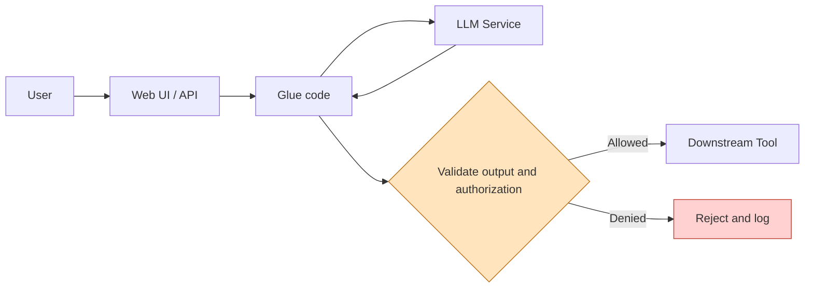
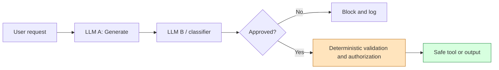
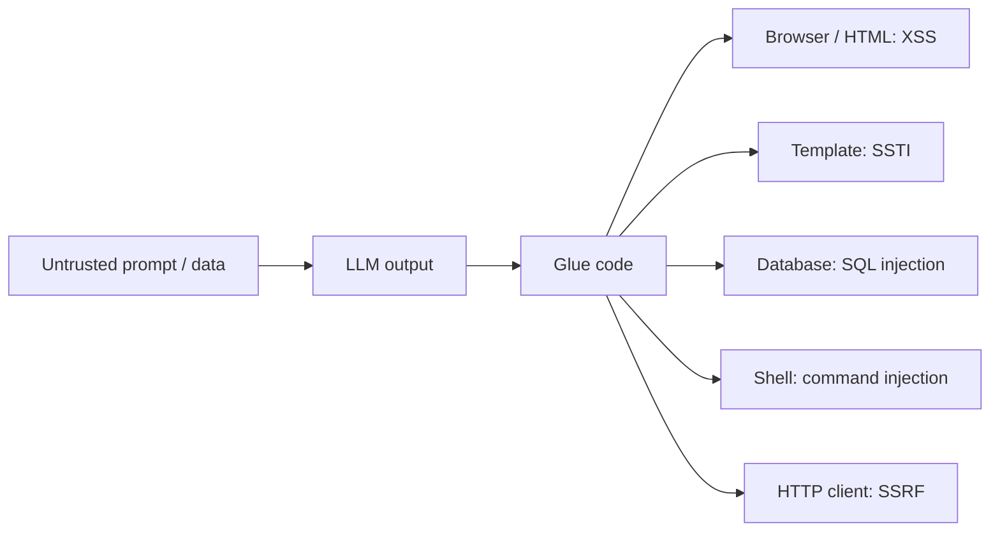
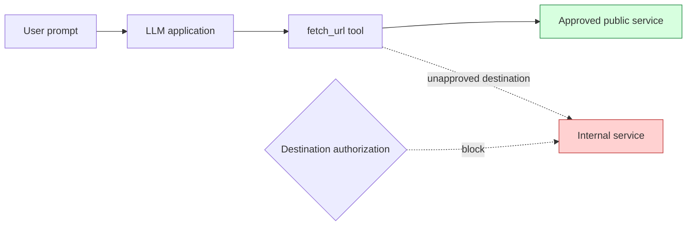

# Chapter 8 — Editable Mermaid Diagram Sources

These are optional, editable Mermaid versions of the four PNG diagrams included with Chapter 8. GitHub renders Mermaid diagrams directly in Markdown. The PNG diagrams are used in the main chapter so that the chapter displays consistently in more Markdown viewers.

## Figure 8.1 — Glue code integration

## Figure 8.2 — LLM filtering chain

## Figure 8.3 — Downstream attack surface

## Figure 8.4 — SSRF through an LLM tool

