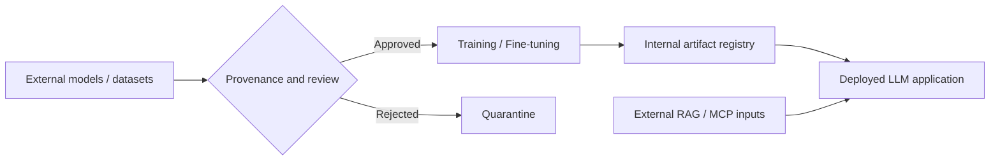
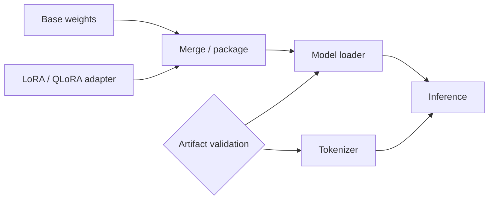
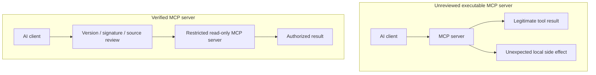

# Chapter 9 — Editable Mermaid Diagrams

The four PNG figures in the chapter have exact-layout Graphviz source files alongside them. These Mermaid versions can be edited directly in GitHub Markdown.

## Figure 9.1 — LLM Supply Chain Lifecycle

## Figure 9.2 — Different Poisoning Timelines

```mermaid
flowchart TB
    subgraph SplitView[Split-view: time-of-check / time-of-use]
      S1[Known snapshot] --> S2[Recommendation]
      S2 --> S3[Source changed after recommendation]
      S3 --> S4[User follows stale advice]
    end
    subgraph FrontRunning[Front-running: before a model update]
      F1[Editable source poisoned] --> F2[Dataset ingestion]
      F2 --> F3[Model update]
      F3 --> F4[Changed model behavior]
    end
    subgraph Rag[RAG poisoning: during retrieval]
      R1[Poisoned document] --> R2[Retriever]
      R2 --> R3[LLM context]
      R3 --> R4[Contaminated answer]
    end
```

## Figure 9.3 — Model Artifact Validation

## Figure 9.4 — MCP Server Integrity

Use Graphviz `render_diagrams.py` when you need exact high-resolution PNG output. That script needs the Graphviz executable and Python `graphviz` package.
